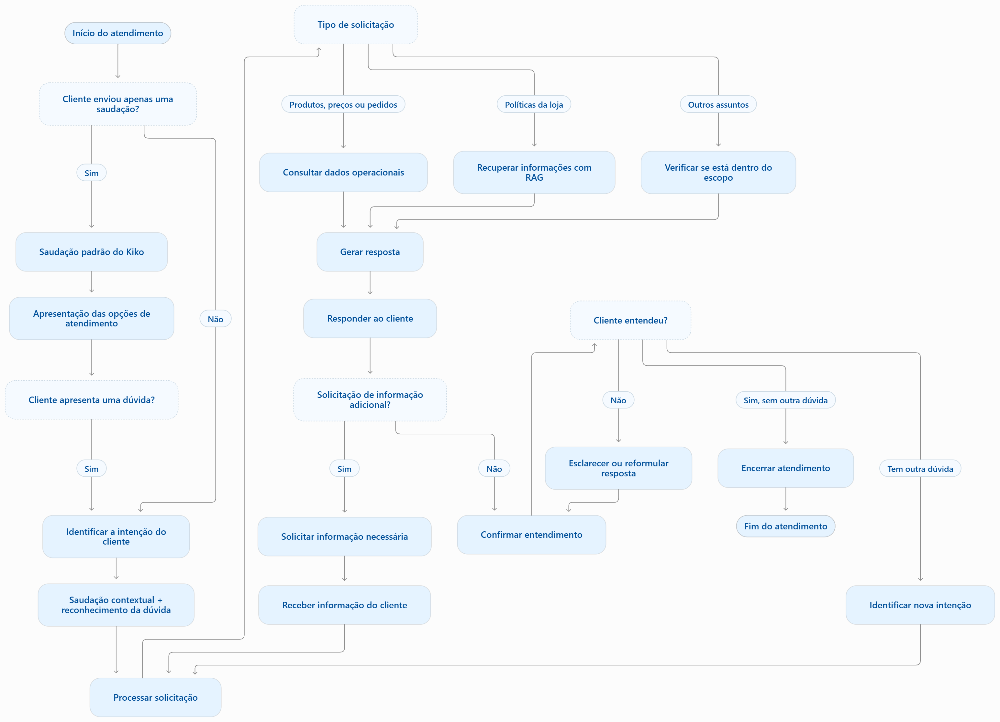

# 🎸 Kiko — Agente de Atendimento da Empório da Música

Agente conversacional desenvolvido em Python para automatizar o atendimento inicial aos clientes da Empório da Música, uma loja fictícia especializada em instrumentos musicais, localizada em Campo Grande, Mato Grosso do Sul.

O projeto foi desenvolvido como parte do desafio técnico AI Engineer Junior – Full-Stack for Generative AI Applications.

O Kiko é o assistente virtual da loja. Seu nome foi escolhido em homenagem ao guitarrista Kiko Loureiro, reforçando a identidade musical do projeto. Sua função é oferecer um atendimento cordial, objetivo e contextualizado, auxiliando os clientes em consultas sobre produtos, pedidos e políticas comerciais.

# 1. Objetivo do projeto

O objetivo foi construir um agente capaz de interpretar mensagens em linguagem natural, identificar a necessidade do cliente e selecionar a fonte de informação ou ferramenta adequada para responder.

O agente foi projetado para trabalhar com três categorias principais de informação:

- Dados operacionais: produtos, preços, disponibilidade em estoque e status de pedidos.
- Informações institucionais e comerciais: políticas de troca e devolução, formas de pagamento e demais orientações da loja.
- Assuntos fora do escopo: solicitações que não estejam relacionadas às atividades da Empório da Música.

Além de responder às perguntas, o Kiko deve identificar quando precisa solicitar informações adicionais, evitar respostas sem fundamento no contexto disponível e manter a continuidade da conversa.

# 2. Fluxo de atendimento planejado

O fluxo foi organizado para que o agente não dependa exclusivamente do modelo de linguagem para decidir todas as operações. Algumas decisões são tratadas diretamente pela aplicação, enquanto outras são encaminhadas ao modelo.

## Etapas do atendimento

1. Recebimento da mensagem: o cliente envia uma mensagem pela interface de atendimento.
2. Identificação da intenção: o agente analisa a solicitação e identifica se é uma saudação, consulta de produto, pedido, política ou outro assunto.
3. Seleção da fonte de informação:
    - Consultas operacionais são encaminhadas às ferramentas conectadas ao banco SQLite.
    - Perguntas sobre políticas são encaminhadas ao mecanismo de recuperação de informações (RAG).
    - Solicitações que não exigem consulta utilizam o contexto da conversa e as instruções do agente.
4. Recuperação das informações: os dados necessários são recuperados do banco de dados ou da base documental.
5. Geração da resposta: o modelo organiza as informações em linguagem natural, respeitando a persona e as instruções definidas.
6. Continuidade do atendimento: a conversa é armazenada durante a sessão para permitir perguntas complementares e utilização do contexto anterior.
7. Encerramento: mensagens de despedida reconhecidas pela aplicação podem receber uma resposta fixa, sem necessidade de uma nova chamada ao modelo.

Este fluxo de atendimento é inspirado no Estilo Meli, tomando como referência minha experiência profissional como Analista de Atendimento no Mercado Livre. A proposta é aplicar características de um atendimento próximo, empático, claro, objetivo e orientado à resolução das necessidades do cliente, adaptando essa experiência ao contexto de uma loja de instrumentos musicais.



# 3. Arquitetura e decisões técnicas

A arquitetura escolhida foi híbrida, combinando recuperação de informações (RAG), Function Calling, regras determinísticas em Python e um modelo de linguagem local. Essa combinação foi adotada porque os diferentes tipos de perguntas exigem mecanismos distintos de consulta.

## 3.1. Linguagem e interface

Python: Único requisito obrigatório do desafio.

Streamlit: Foi utilizado para construir uma interface simples de atendimento, permitindo visualizar a conversa entre o cliente e o Kiko sem a necessidade de desenvolver um frontend separado. A interface possui uma página inicial com informações institucionais da loja e uma página de atendimento com histórico visual das mensagens.

## 3.2. Modelo de linguagem e provedor

Modelo: Qwen 2.5 3B
Provedor: Ollama (execução local)

A escolha do Qwen 2.5 3B considerou a possibilidade de executar o modelo localmente, sem depender de uma API paga ou de credenciais externas.

O Ollama foi utilizado como provedor de inferência e integração com o modelo, permitindo realizar chamadas conversacionais e Function Calling.

A temperatura foi configurada como zero nas chamadas principais, buscando maior consistência nas respostas.

A escolha também considerou a viabilidade de execução em ambiente local, embora modelos menores possam apresentar limitações na interpretação de instruções complexas, no uso de ferramentas e na geração de respostas factualmente consistentes.

## 3.3. Arquitetura híbrida: RAG + Function Calling

A principal decisão arquitetural foi separar as consultas operacionais das consultas documentais.

Function Calling — dados operacionais: 

Foi utilizado para permitir que o modelo solicite a execução de ferramentas específicas, de acordo com a necessidade identificada na conversa.

As ferramentas implementadas incluem:

- search_products: pesquisa produtos no catálogo.
- get_product_details: consulta informações detalhadas de um produto.
- get_order_status: consulta o status de um pedido.
- search_store_policies: disponibiliza a recuperação de informações das políticas.

As ferramentas operacionais utilizam o banco SQLite como fonte de dados.

Essa abordagem evita depender exclusivamente do conhecimento interno do modelo para responder perguntas sobre preços, estoque e pedidos.

RAG — políticas e informações documentais:

O mecanismo RAG foi utilizado para consultar informações presentes no manual de políticas e procedimentos da loja.

O fluxo consiste em:

- Extração do conteúdo do documento PDF.
- Fragmentação do texto em trechos menores (chunks).
- Geração de embeddings para representar semanticamente os trechos.
- Armazenamento dos vetores no ChromaDB.
- Recuperação dos trechos relacionados à pergunta do cliente.
- Envio do contexto recuperado ao modelo para elaboração da resposta.

A estratégia de embeddings utilizada foi paraphrase-multilingual-MiniLM-L12-v2, escolhida por oferecer suporte a múltiplos idiomas, incluindo português.

O ChromaDB foi utilizado como banco vetorial, permitindo persistir os embeddings e realizar buscas por similaridade semântica.

A separação entre RAG e Function Calling foi importante porque políticas comerciais e dados operacionais possuem características diferentes: as primeiras são informações documentais, enquanto os segundos exigem consultas estruturadas e atualizadas.

## 3.4. Banco de dados

SQLite: Foi escolhido por ser leve, relacional e suficiente para o escopo do desafio, dispensando a configuração de um servidor de banco de dados. O banco armazena as informações operacionais utilizadas pelo agente, incluindo produtos, estoque e pedidos.

## 3.5. Estratégia de prompt e persona

O comportamento do Kiko é orientado por um prompt de sistema (SYSTEM_PROMPT), que estabelece:

- Identidade e função do assistente.
- Tom cordial, prestativo e profissional.
- Contexto de atuação da Empório da Música.
- Orientação para utilizar as informações recuperadas.
- Instrução para não inventar preços, disponibilidade ou regras.
- Tratamento de informações insuficientes.
- Solicitação de dados adicionais quando necessários.
- Respostas em português brasileiro.

Também foram utilizadas instruções específicas nas consultas documentais, buscando reduzir respostas contraditórias e evitar a mistura de regras de diferentes situações.

Além das instruções enviadas ao modelo, algumas regras foram implementadas diretamente em Python, como a apresentação inicial, a solicitação de dados para consultas de pedidos e o encerramento determinístico do atendimento.

Essa separação permite manter sob controle da aplicação comportamentos que não precisam depender da interpretação probabilística do LLM.

# 4. Etapas de construção do agente

O desenvolvimento foi realizado de forma incremental, priorizando a construção e validação dos componentes antes da integração completa.

## Etapa 1 — Exploração e validação dos dados

Inicialmente, foram analisados os arquivos de dados disponibilizados para compreender sua estrutura, relacionamentos, campos e possíveis inconsistências.

Foram realizadas verificações de:

- Quantidade de registros e colunas.
- Valores ausentes.
- Registros duplicados.
- Integridade de identificadores e relacionamentos.
- Consistência de campos e domínios.

Essa etapa foi importante para compreender as fontes de informação que seriam utilizadas pelo agente.

## Etapa 2 — Implementação do acesso aos dados

Foi desenvolvido o repositório responsável pelas consultas ao SQLite.

Em seguida, foram implementadas as ferramentas para pesquisa de produtos, consulta de detalhes e acompanhamento de pedidos.

## Etapa 3 — Construção da base documental

O manual de políticas foi processado para permitir consultas semânticas.

Foram realizados experimentos com diferentes configurações de fragmentação e recuperação, buscando melhorar a relevância dos trechos encontrados.

## Etapa 4 — Desenvolvimento do agente

A função principal ask_agent foi construída para coordenar o fluxo de atendimento, incluindo:

- Identificação de intenções.
- Recuperação de políticas.
- Execução de ferramentas.
- Gerenciamento do histórico.
- Geração das respostas.
- Tratamento de situações sem informações suficientes.

## Etapa 5 — Desenvolvimento da interface

Foi construída uma interface com Streamlit para permitir a interação textual com o Kiko e visualizar o histórico da conversa.

## Etapa 6 — Integração e testes

Por fim, os componentes foram integrados e submetidos a testes automatizados e cenários manuais com o modelo local.

# 5. Testes e experimentos

A validação foi dividida em duas frentes: testes dos componentes e testes de interação com o agente integrado.

## 5.1. Testes automatizados

Foram desenvolvidos testes com Pytest para verificar componentes como:

- Consultas ao repositório de dados.
- Recuperação de informações documentais.
- Comportamentos da lógica principal do agente.

Esses testes ajudam a verificar o funcionamento dos componentes de maneira isolada e a identificar regressões durante o desenvolvimento.

## 5.2. Experimentos de RAG

Foram realizados experimentos para avaliar a recuperação semântica de trechos do manual.

Na versão mais recente dos experimentos:

- Foram gerados 18 embeddings.
- Cada embedding possui 384 dimensões.
- Foram avaliadas cinco consultas.
- Três consultas recuperaram um trecho relevante na primeira posição.
- Quatro consultas recuperaram um trecho relevante entre os três primeiros resultados.

Os resultados indicaram uma melhora na recuperação em relação à configuração anterior, mas também demonstraram que a relevância não foi uniforme para todas as perguntas.

O cenário de troca por preferência apresentou dificuldade de recuperação entre os três primeiros resultados, evidenciando a necessidade de aprimorar a estratégia de busca.

Os resultados devem ser interpretados como uma avaliação manual exploratória, realizada com uma amostra pequena de consultas, e não como uma validação estatística abrangente.

## 5.3. Testes manuais de integração

Foram realizadas duas execuções dos mesmos cinco cenários, utilizando o Qwen 2.5 3B via Ollama, integrado ao SQLite e ao ChromaDB. A avaliação considerou a identificação da intenção, a escolha da fonte de informação, a resposta e a continuidade da conversa.

**01 – Saudação inicial**

- Fluxo esperado: apresentar o assistente e suas funcionalidades, sem consultas às bases.
- Resultado: nas duas execuções, o Kiko apresentou a mesma saudação e listou corretamente suas funcionalidades.
- Análise: comportamento consistente e alinhado ao esperado.

**02 – Busca de produtos**

- Fluxo esperado: consultar o catálogo no SQLite, aplicando os filtros de categoria, preço e disponibilidade.
- Resultado: nas duas execuções, o agente informou que não encontrou violões até R$ 1.000.
- Análise: reconheceu a intenção, mas não apresentou produtos. É necessário validar a aplicação dos filtros e os resultados retornados pela consulta.

**03 – Política de arrependimento**

- Fluxo esperado: recuperar a política pelo RAG e responder com base no manual.
- Resultado: nas duas execuções, informou corretamente o prazo de 7 dias, as condições do produto, o prazo de reembolso e a responsabilidade pelo frete.
- Análise: respostas consistentes e alinhadas ao fluxo esperado.

**04 – Consulta de pedido**

- Fluxo esperado: solicitar número do pedido e telefone cadastrado antes da consulta operacional.
- Resultado: na primeira execução, o agente apresentou uma mensagem genérica de erro. Na segunda, solicitou corretamente os dados necessários.
- Análise: houve inconsistência na coleta de informações obrigatórias, indicando a necessidade de reforçar essa etapa do fluxo.

**05 – Continuidade: troca por preferência e por defeito**

- Fluxo esperado: recuperar a política pelo RAG e manter o contexto ao responder à pergunta seguinte.
- Resultado: nas duas execuções, o agente reconheceu os assuntos e respondeu às perguntas. Entretanto, apresentou orientações diferentes sobre o procedimento de troca. Na segunda execução, também repetiu a saudação ao responder sobre defeito.
- Análise: houve continuidade parcial da conversa, mas as respostas apresentaram variações e informações adicionais cuja correspondência com o manual precisa ser validada.

**Análise geral:** os melhores resultados ocorreram na saudação e na consulta sobre arrependimento. Os testes também evidenciaram limitações na busca de produtos, inconsistência na solicitação de dados para pedidos e variações na recuperação e interpretação das políticas. A comparação demonstra que a execução técnica foi concluída, mas nem sempre o comportamento funcional esperado foi alcançado.

Os registros brutos das duas execuções estão disponíveis no diretório `test_results/`.

## 5.4 - Testes complementares pela interface Streamlit

Além dos cenários executados pelo script, foram realizados testes diretamente pela interface para avaliar o fluxo de atendimento em situações complementares.

**01 – Consulta de teclados**

- Fluxo esperado: identificar a intenção de pesquisa, consultar o catálogo no SQLite e apresentar produtos, preços e disponibilidade.
- Resultado: o agente apresentou três teclados, com preços, quantidades em estoque e características.
- Análise: comportamento alinhado ao fluxo esperado, demonstrando a integração com os dados operacionais.

**02 – Encerramento após consulta de política**

- Fluxo esperado: após responder à dúvida e receber uma confirmação de que o cliente não precisa de mais ajuda, identificar a intenção de encerramento e apresentar uma mensagem final.
- Resultado: após a mensagem "ficou claro, obrigada", o agente repetiu a orientação sobre devolução antes de apresentar o encerramento.
- Análise: o encerramento foi realizado, mas houve uma resposta intermediária desnecessária, indicando uma limitação no reconhecimento da intenção de finalizar o atendimento.

**03 – Pergunta fora do escopo**

- Fluxo esperado: identificar uma pergunta não relacionada à loja e redirecionar o cliente, sem realizar consultas às bases operacionais ou documentais.
- Resultado: ao receber uma pergunta sobre qual país ganhou a Copa, o Kiko informou que não poderia fornecer diretamente essa informação e direcionou a conversa para assuntos relacionados à loja.
- Análise: comportamento alinhado ao limite de escopo definido para o assistente.

**04 – Consulta sobre pagamento via PIX**

- Fluxo esperado: identificar uma dúvida sobre pagamento, recuperar a política correspondente pelo RAG, responder e manter o contexto para perguntas complementares. Ao receber uma manifestação de encerramento, finalizar o atendimento.
- Resultado: o agente informou a aceitação de PIX e o desconto de 5%, confirmou sua aplicação em compras pelo site e encerrou a conversa após o cliente informar que era só isso.
- Análise: comportamento alinhado ao fluxo esperado, demonstrando recuperação de política, continuidade contextual e encerramento adequado.

**05 – Consulta de preço do Takamine GD20**

- Fluxo esperado: identificar a solicitação de preço, consultar o catálogo no SQLite e apresentar o valor e a disponibilidade do produto.
- Resultado: o agente não encontrou o produto, mesmo após o cliente informar o nome completo do instrumento.
- Análise: o comportamento não atendeu ao fluxo esperado. Como o produto consta no catálogo, o cenário evidencia uma limitação na busca ou recuperação dos dados operacionais.

**Análise geral:** os testes complementares demonstraram o funcionamento da consulta de produtos, recuperação de políticas, tratamento de perguntas fora do escopo e encerramento. Também evidenciaram limitações no reconhecimento de encerramento após respostas documentais e na localização de produtos específicos no catálogo.

Os registros da interface estão disponíveis no diretório `examples/`.

# 6. Limitações conhecidas e melhorias futuras

Durante os testes, foram identificadas oportunidades de melhoria:

- Recuperação de produtos: dificuldades na aplicação de filtros de categoria, preço e disponibilidade. Como melhoria, aprimorar as consultas ao SQLite e a validação dos resultados.
- Precisão das respostas documentais: foram observadas inconsistências em algumas respostas sobre trocas e devoluções. Como melhoria, aprimorar a fragmentação dos documentos, a recuperação híbrida e a validação das respostas com base nos trechos recuperados.
- Interpretação de intenções e continuidade: ocorreram falhas no reconhecimento de encerramento e na manutenção do contexto. Como melhoria, aperfeiçoar o gerenciamento do histórico e os testes de intenção.
- Consulta de pedidos: necessidade de tornar mais consistente a solicitação e validação dos dados necessários para localizar pedidos.
- Avaliação: ampliar os cenários de teste e estabelecer métricas para avaliar a precisão das respostas, a recuperação de informações e o uso correto das ferramentas.

# 7. Uso de assistentes de código e ferramentas de IA

Durante o desenvolvimento, foi utilizado o ChatGPT (OpenAI) como ferramenta de apoio técnico.

A ferramenta foi utilizada para:
- Apoiar a implementação e revisão de trechos de código.
- Investigar erros e comportamentos inesperados.
- Organizar a documentação técnica e a organização do projeto.
- Sugerir cenários de teste.

As decisões de arquitetura, integração dos componentes, realização dos experimentos e avaliação dos resultados fizeram parte do meu processo de desenvolvimento. O ChatGPT foi utilizado como apoio à programação e à análise técnica, não como substituto da implementação e validação do projeto.

# 8. Estrutura do projeto

O projeto está organizado em módulos para separar a interface, a lógica do agente, o acesso aos dados, a recuperação de informações e os testes.

```text
emporio-musica-agente/
│
├── app.py
├── requirements.txt
├── requirements-rag.txt
├── .gitignore
│
├── data/
│   ├── raw/
│   │   ├── categories.csv
│   │   ├── customers.csv
│   │   ├── orders.csv
│   │   ├── order_items.csv
│   │   ├── products.csv
│   │   └── promotions.csv
│   └── chroma/
│
├── database/
│   ├── emporio_musica.sqlite
│   └── emporio_musica_schema.sql
│
├── docs/
│   └── fluxograma_atendimento.png
│
├── examples/
│   ├── example_01.png
│   ├── example_02.png
│   ├── example_03.png
│   ├── example_04.png
│   └── example_05.png
│
├── knowledge/
│   └── políticas_da_loja.pdf
│
├── notebooks/
│   ├── 01_exploracao_validacao_dados.ipynb
│   ├── 02_experimentos_rag_v1.ipynb
│   └── 02_experimentos_rag_v2.ipynb
│
├── src/
│   ├── agent.py
│   ├── rag/
│   │   ├── chunker.py
│   │   ├── document_loader.py
│   │   ├── embedding.py
│   │   ├── pipeline.py
│   │   └── vector_store.py
│   └── repositories/
│       └── store_repository.py
│
├── tests/
│   ├── manual_agent_scenarios.py
│   ├── test_agent.py
│   ├── test_chunker.py
│   ├── test_repository.py
│   └── test_vector_store.py
│
└── test_results/
    ├── conversas_qwen_20261103_133510.md
    └── conversas_qwen_20261103_172226.md
```

**Descrição dos principais diretórios:**

- `app.py`: interface conversacional desenvolvida com Streamlit.
- `data/`: arquivos CSV fornecidos no desafio e armazenamento persistente do ChromaDB.
- `database/`: banco SQLite e arquivo SQL com a estrutura das tabelas.
- `docs/`: documentação visual, incluindo o fluxograma de atendimento.
- `examples/`: imagens com exemplos de interações do agente.
- `knowledge/`: documentos utilizados como fonte para as respostas sobre políticas da loja.
- `notebooks/`: exploração e validação dos dados e experimentos de recuperação RAG.
- `src/`: implementação do agente, dos componentes RAG e do repositório de acesso aos dados.
- `tests/`: testes automatizados e cenários de execução manual.
- `test_results/`: registros das conversas realizadas durante os testes manuais.

# 9. Configuração e execução

**Pré-requisitos**

- Python 3.10 ou superior.
- Git.
- Ollama instalado.
- Modelo `qwen2.5:3b` disponível no Ollama.

## 9.1. Clonar o repositório

```bash
git clone https://github.com/ana0212/emporio-musica-agente
cd emporio-musica-agente
```

## 9.2. Criar ambiente virtual

**Windows:**

```bash
python -m venv .venv
.venv\Scripts\activate
```

**Linux/macOS:**

```bash
python3 -m venv .venv
source .venv/bin/activate
```

## 9.3. Instalar dependências

```bash
python -m pip install -r requirements.txt
python -m pip install -r requirements-rag.txt
```

## 9.4. Preparar o modelo local

Com o Ollama instalado, baixe o modelo utilizado pelo agente:

```bash
ollama pull qwen2.5:3b
```

Verifique se o modelo está disponível:

```bash
ollama list
```

Mantenha o serviço do Ollama em execução durante a utilização do agente.

## 9.5. Executar a aplicação

Na raiz do projeto, execute:

```bash
streamlit run app.py
```

A aplicação será disponibilizada no endereço local informado pelo Streamlit, normalmente:

```text
http://localhost:8501
```

## 9.6. Executar testes automatizados

Para executar a suíte de testes:

```bash
python -m pytest -v
```

## 9.7. Executar cenários manuais de integração

Para executar os cenários de interação com o modelo local:

```bash
python tests/manual_agent_scenarios.py
```

Esse script realiza interações com o modelo local e registra os resultados dos cenários executados no diretório `test_results/`.

# 10. Considerações finais
O desenvolvimento do Kiko permitiu explorar, na prática, diferentes componentes de uma aplicação baseada em modelos de linguagem: integração com dados estruturados, recuperação semântica de documentos, Function Calling, gerenciamento de contexto e interface conversacional.

A principal decisão foi não tratar o LLM como única fonte de informação ou responsável por todas as operações. A arquitetura distribui responsabilidades entre regras implementadas em Python, ferramentas de consulta, recuperação documental e geração de linguagem natural.

Os testes também demonstraram que a integração desses componentes exige validação contínua: uma resposta fluente não significa necessariamente uma resposta correta.

O projeto representa uma primeira versão funcional do agente, com uma arquitetura que permite evoluções futuras em precisão, confiabilidade, avaliação e experiência de atendimento.